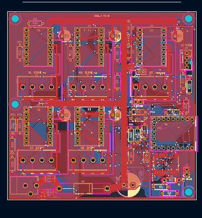
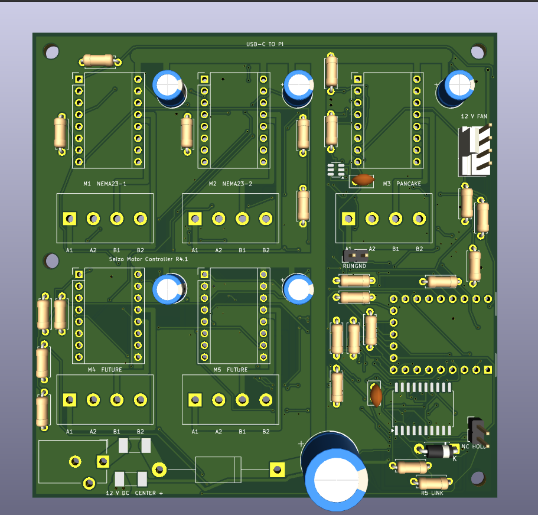

# Seizo Mini — Robotic Arm Motor Controller

This project is a motor controller for a robotic arm I want to build using two NEMA 23 motors and three NEMA 17 motors. It will be a big, complex project, but I believe I can build it with enough hard work and determination. I've wanted to build a robotic arm like this since I was five, so this means a lot to me.

The Raspberry Pi sends commands to the controller, the controller sends signals to the drivers, and the drivers control the motors. A separate power supply provides the motor power. One USB-C cable connects the new controller to a USB-A port on my Raspberry Pi 4, which simplifies its wiring.

## What I worked on

I made the basic schematic, did some component placement and completely routed an earlier version of the PCB. My friend helped with routing and planning the power circuit. Later revisions changed the schematic and PCB, including power-related issues. I wanted to be careful because the motors are expensive and I don't want to damage them.

Budgeting was the hardest problem. I researched cheaper options and worked out which parts I could reuse, including my power supply and the drivers on my existing CNC shield. Fitting everything into the budget took a lot of work. Funding would really help me build and test the next part of this project. Thank you so much for considering it.

## How the current build connects

| Part | Job |
| --- | --- |
| New R4.1 PCB, U1/J1 and U2/J2 | Two suitably rated NEMA 23 motors, using new BTT TMC2209 V1.3 modules |
| New PCB, U3 | Third TMC module stays fitted for the supplied three-driver firmware checks; leave J3 without a motor in this five-motor arm plan |
| New PCB, U4/U5 | Future sockets; no driver modules fitted |
| Existing CNC shield and Arduino Uno | Three NEMA 17 axes using my existing A4988 drivers |
| RP2040-Zero module on the new PCB | USB-C communication with the Pi; its USB socket is part of the module, not a separate carrier connector |

The new PCB uses one USB connection. The separate Arduino/CNC controller keeps its own existing connection. The owned A4988 modules stay on the CNC shield: they are **not interchangeable with the TMC modules in this PCB's sockets**. A fourth CNC-shield driver socket does not automatically provide a fourth independent axis.

## Power and testing

I have a 12 V, 4 A supply, and I tested my existing setup with the supply and four driver boards. This is my report of that existing setup; the new assembled PCB and NEMA 23 motors have not been tested yet. After assembly, I plan to check the board itself, then test suitable motors one at a time before connecting the full arm.

The supply is rated for **48 W total**. A buck converter cannot increase that power. The new carrier is a 12 V-only design with an initial shared input qualification envelope of at most 2.5 A/30 W; that envelope is not an electronic current clamp or a physically qualified continuous rating. Sharing the adapter between both controllers requires a checked distribution arrangement and measured combined load. Motor frame size alone does not establish winding-current compatibility or enough torque to lift the arm.

The latest schematic and PCB checks reported zero violations, unconnected items or schematic mismatches. The manufacturing layer/drill comparison passed. Reference firmware and host software have automated checks, including 50 host tests. These are digital checks, not a guarantee that an assembled board will work or that a loaded arm is safe. The delivered firmware remains motion-locked; integration with the existing Pi/Uno application and physical calibration remain.

## Parts, assembly and fallback

The current [funding BOM](BOM.csv) lists only selected purchases with numeric prices. The [full BOM](Real_BOM.csv) also records owned parts, unused sockets and assembly details. Shipping and other allowances are separate in the [budget](motor-controller-r4-1/cost/READ_FIRST.md). The three original displayed totals were $41.54 + $14.50 + $18.86 = **$74.90**, before any added cooling/fallback purchases and any later destination charges excluded by the sellers. The current budget file governs the revised plan; no order has been placed by this update.

The budget build requires hand assembly, including U7/U8. See the [buy-and-solder instructions](motor-controller-r4-1/BUY_AND_SOLDER_MANUAL.md) and [first-power checks](motor-controller-r4-1/ASSEMBLY_AND_FIRST_POWER.md). A soldering fault must be inspected and repaired while unpowered; fuses cannot make arbitrary soldering errors harmless.

The existing CNC setup remains available for its original motors, and the five-board batch leaves spare bare carriers. The selected preassembled fallback candidate is the Mellow FLY-D5 V1.0 board-only option at $18, reusing the same plug-in TMC2209 modules. Its manufacturer documents 12–24V input, TMC2209 sockets and USB-C host communication. It needs its own correctly configured firmware, jumper settings and checked power harness; it is not compatible with the custom RP2040 firmware. The fallback has not been physically tested.

## Current design files

- [KiCad schematic](<motor-controller-r4-1/project/big motor controller.kicad_sch>), [PCB](<motor-controller-r4-1/project/big motor controller.kicad_pcb>) and [project](<motor-controller-r4-1/project/big motor controller.kicad_pro>).
- [Gerbers/drills](motor-controller-r4-1/fabrication/), [connections](motor-controller-r4-1/assembly/CONNECTIONS_AND_ORIENTATION.md), [locked firmware](motor-controller-r4-1/firmware/) and [USB host reference](motor-controller-r4-1/host/).
- [Cart screenshots](motor-controller-r4-1/cart-proof/) and [submission file guide](motor-controller-r4-1/SUBMISSION_FILES.md). Earlier teaching-arm and R4 designs remain preserved separately.

These are CAD screenshots, not photographs of an assembled board. Some component models are missing, including the MCU and its USB-C socket. The fan header shown in the render is not fitted in the current manual build; the specified blower wires connect directly to J8 pads 1/2 with strain relief.

## AI assistance

I made the original schematic and routed an earlier PCB version. For later revisions, ChatGPT generated and revised schematic and PCB files, including placement and routing, helped select parts, generated the reference firmware, and ran digital checks. Those checks helped find issues, but they do not guarantee that the board or motors will be safe or work without physical testing.

## Current priced BOM update

The root BOM now uses Item, Qty, Supplier, Cost/item, Total Cost and link columns, with 25 selected purchase lines and no blank or zero purchase prices. Selected merchandise totals $64.69, excluding shipping. Including the $18 fallback raises the previously displayed $76.38 basis to $94.38 before unquoted Adafruit/Mellow delivery, any later duties/tax and any required fallback power connector. Only $5.62 remains to the $100 cap; the delivered build is NOT confirmed below $100. This replaces the earlier $5 external-driver adaptation allowance, not an additional allowance. Use the current priced BOM when replacing the stale saved app list; syncing an old zero-price list back can overwrite this file again. Earlier budget-allocation documents describe the previous option and are superseded by this price update.
