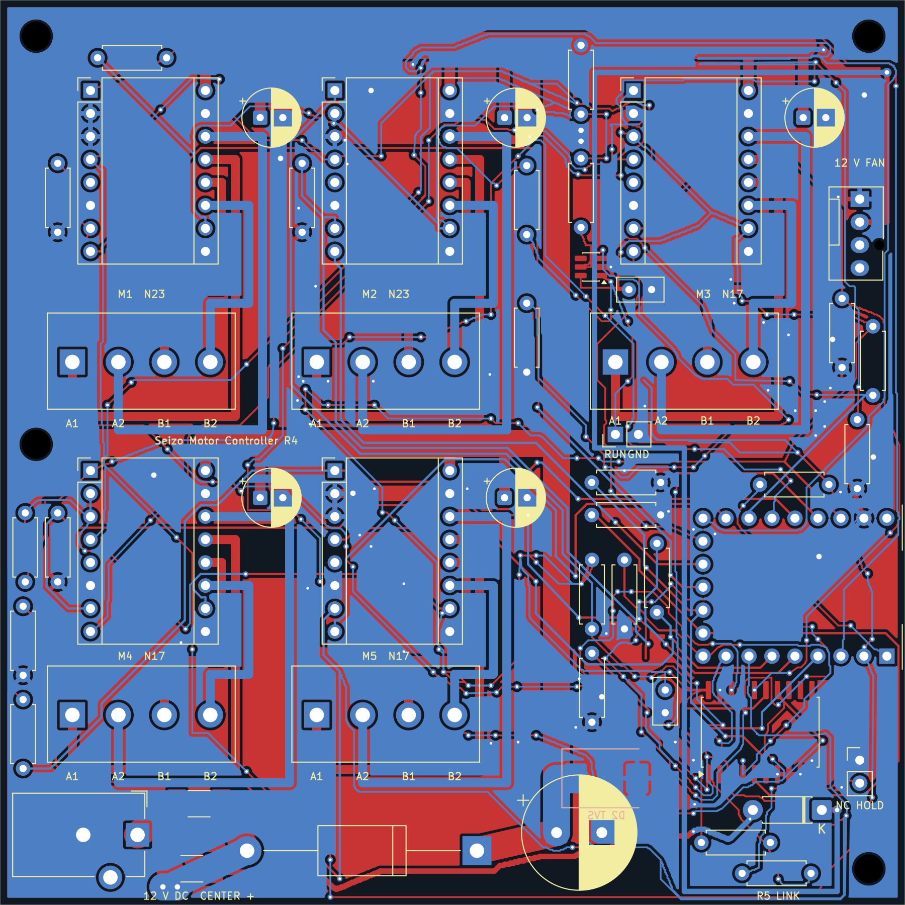
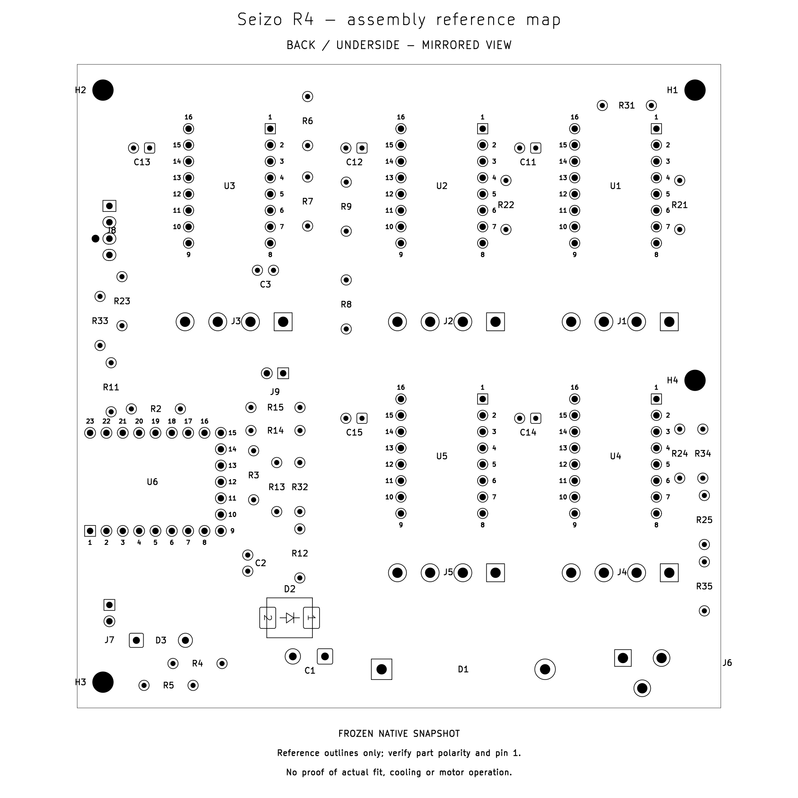

# Seizo Mini — Motor Controller R4

This is a pretty big motor controller for the next version of my robotic arm. After my previous arm was damaged, I started thinking about how I could improve it. I wanted stronger geared joints, more lifting ability and a more professional build. Eventually, I want to use NEMA 23 motors for a bigger arm. This PCB is part of that direction.

## What it does

The controller has five replaceable TMC2209 driver slots: two intended for suitable NEMA 23 motors and three for suitable NEMA 17 motors, including pancakes. The winding current and required torque still have to match the drivers; motor size alone does not prove compatibility.

One USB-C data connection links this controller to my Raspberry Pi 4 through a Pi USB-A port. A separate 12 V supply powers the motors. It includes fuses, input protection, a motor-supply reset monitor and HOLD. HOLD is not an independent emergency stop or brake. My existing CNC shield stays separate if used.

## What I learned

The budget has been one of the hardest parts. I researched components, compared prices and kept changing the plan to work out what I could afford. Shipping, tax, import charges and the power supply all matter. This taught me a lot about budgeting and motor electronics.

The target is **$100 delivered**. The current manual-assembly plan is **$98.84 before unquoted import fees**. Factory assembly is not included. The uploaded factory quote is **$137 before delivery**, with the controller module and wire link still excluded, so that route exceeds the budget. The [quote breakdown](motor-controller-r4/cost/CHECKOUT_SUMMARY.md) separates actual checkout prices from estimates.

## Current status

This is a design prototype. Digital schematic, PCB and manufacturing-file checks pass, but the assembled hardware has not been tested. The reference firmware is movement-locked for commissioning. Motor compatibility, power behavior, cooling and assembly still need testing before running a loaded arm.

This revision is the motor controller. The earlier [teaching-arm and encoder-reader design](legacy/teaching-mini-r5/) is archived separately.

Funding would really help me build and test this next step. Thank you so much for considering it.

## Current files

- [KiCad project](<motor-controller-r4/project/big motor controller.kicad_pro>), [schematic](<motor-controller-r4/project/big motor controller.kicad_sch>) and [PCB](<motor-controller-r4/project/big motor controller.kicad_pcb>)
- [Full purchase BOM](motor-controller-r4/cost/Final_BOM.csv) and [LCSC import](motor-controller-r4/cost/R4-LCSC-import.csv)
- [PCB check summary](motor-controller-r4/FOUR_PASS_PCB_REVIEW.md) and [assembly instructions](motor-controller-r4/ASSEMBLY_AND_FIRST_POWER.md)

## AI assistance

I made the original schematic and routed an earlier PCB version. For later revisions, ChatGPT generated and revised schematic and PCB files, including placement and routing, helped select parts, generated the reference firmware, and ran digital checks. Those checks helped find issues, but they do not guarantee that the board or motors will be safe or work without physical testing.

