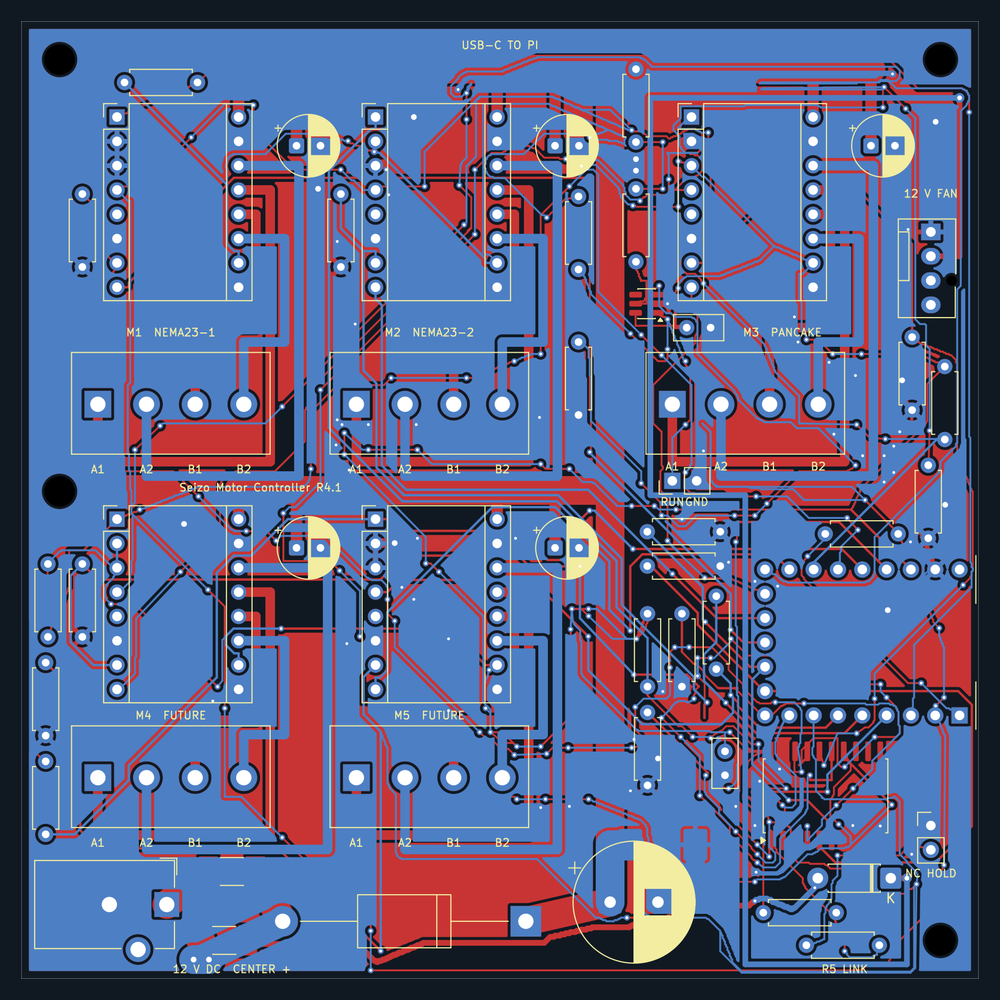
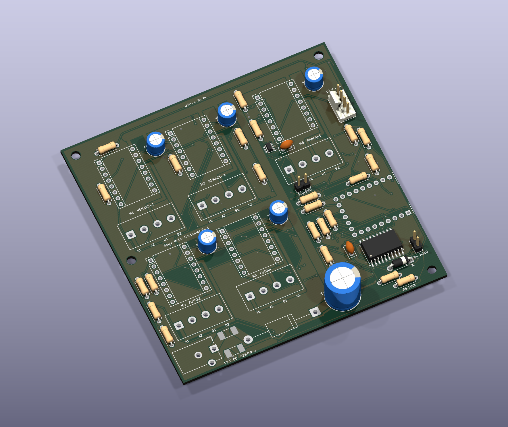

# Seizo Mini — Motor Controller R4.1

This is a pretty big motor controller for the next version of my robotic arm. After my previous arm was damaged, I started thinking about how I could improve it. I wanted stronger geared joints, more lifting ability and a more professional build. Eventually, I want to use NEMA 23 motors for a bigger arm. This PCB is part of that direction.

## What this revision does

One USB-C data cable connects this controller to my Raspberry Pi 4 through a Pi USB-A port. A separate, reused 12 V adapter powers the motors. The board has five replaceable driver sockets, but this build fits **three TMC2209 V1.3 modules**. My existing Arduino/CNC shield stays unchanged for the three full-size NEMA 17 motors.

| Board label | Driver / motor connector | Intended use |
| --- | --- | --- |
| M1 NEMA23-1 | U1 / J1 | First suitably rated NEMA 23 |
| M2 NEMA23-2 | U2 / J2 | Second suitably rated NEMA 23 |
| M3 PANCAKE | U3 / J3 | One suitably rated NEMA 17 pancake |
| M4 FUTURE, M5 FUTURE | U4 / J4, U5 / J5 | Leave driver modules empty in this build |

All motor connectors are upright screw terminals, labelled **A1, A2, B1, B2** for the two coil pairs. The drivers plug into female socket rows. The RP2040-Zero-M has its own USB-C socket and is soldered into the carrier through its header pins. There is also a required short RUN/GND reset harness; the [connection guide](motor-controller-r4-1/assembly/CONNECTIONS_AND_ORIENTATION.md) explains it.

NEMA size describes a motor's frame, not its winding current or torque. These intended slot names do **not** make the board compatible with every NEMA 23 or prove that it can lift a particular load. Exact motor ratings and the mechanism still need checking.

## What changed

R4.1 moves the small chip's escape vias away from its solder lands, adds clearer motor and future-slot labels, and updates the reference firmware for three fitted drivers. It includes input protection, fuses, a motor-supply reset monitor and HOLD. HOLD is not an independent emergency stop or brake.

The supplied firmware is **movement-locked**. Schematic checks and PCB checks passed with zero errors, warnings, unconnected nets or schematic mismatches. The software passed 6,987 regression checks and 651 checks for the three-driver setup, and the RP2040 build compiled successfully. These are digital checks; no assembled board or motor has been tested by this release process.

## Budget and assembly

Budgeting has been one of the hardest parts. I researched components, compared prices and kept changing the plan to work out what I could afford. Shipping, tax, import charges and the power supply all matter. This taught me a lot about budgeting and motor electronics.

The target is **$100 delivered**. The current conservative plan is **$110.21 before unquoted import or checkout charges**, so the target is **not met**. This excludes motors and tools and reuses my owned adapter. See the [full BOM](motor-controller-r4-1/cost/Final_BOM.csv) and [cost explanation](motor-controller-r4-1/cost/READ_FIRST.md); unknown charges are not counted as zero.

That adapter is allocated to this carrier. The existing CNC shield still needs motor power. Running both controllers together from one adapter has not been qualified; a separate suitable supply or rated distribution may cost extra.

The partial assembly quotation fits **only U7 and U8**, the two small ICs, on two boards from a five-board batch. Its observed estimate is $32.79 including estimated shipping and one conditional $10 coupon, which expires November 10, 2026. This is not a fully soldered controller or the whole project price. Fuses, the rear protection diode, through-hole parts, MCU, socket rows, driver modules, heatsinks, fan and reset harness still need fitting. Final supplier review and placement approval remain pending.

## Current files

- [KiCad project](<motor-controller-r4-1/project/big motor controller.kicad_pro>), [schematic](<motor-controller-r4-1/project/big motor controller.kicad_sch>) and [PCB](<motor-controller-r4-1/project/big motor controller.kicad_pcb>)
- [Full purchase BOM](motor-controller-r4-1/cost/Final_BOM.csv), [what to solder](motor-controller-r4-1/cost/Solder_List.csv) and [assembly instructions](motor-controller-r4-1/ASSEMBLY_AND_FIRST_POWER.md)
- [Connections and orientation](motor-controller-r4-1/assembly/CONNECTIONS_AND_ORIENTATION.md), [repair and fallback](motor-controller-r4-1/RECOVERY_AND_FALLBACK_R41.md) and [verification summary](motor-controller-r4-1/checks/labeled-freeze-review.json)
- [Matching partial assembly quotation files](motor-controller-r4-1/assembly/quotation-only/), [Gerbers and drills](motor-controller-r4-1/fabrication/) and [locked reference firmware](motor-controller-r4-1/firmware/)

Both images come from this exact PCB. The 3D render has incomplete model coverage, including the driver modules, MCU and motor terminals; it is not a prediction of a fully assembled board.

## What still needs testing

This is a reviewed design prototype. It is **not cleared for production, ordering within the $100 cap, or running a loaded arm**. Exact driver revision and heatsink supplies, motor suitability, supplier CAM/placement review, soldering, adapter fit and polarity, actual current, cooling, USB/UART, reset behavior and regenerated motor voltage still need qualification. The reference USB protocol also needs integration and testing with the Pi's arm application; a cable alone does not complete that software work. A gravity-loaded arm can fall when power or holding torque is lost. The existing CNC/Uno is the fallback for its current three motors; it is not a guaranteed replacement for the new NEMA 23 channels.

The earlier [R4 motor-controller files](motor-controller-r4/) and [teaching-arm/encoder-reader design](legacy/teaching-mini-r5/) are preserved separately. Funding would really help me build and test this next step. Thank you so much for considering it.

## AI assistance

I made the original schematic and routed an earlier PCB version. For later revisions, ChatGPT generated and revised schematic and PCB files, including placement and routing, helped select parts, generated the reference firmware, and ran digital checks. Those checks helped find issues, but they do not guarantee that the board or motors will be safe or work without physical testing.

