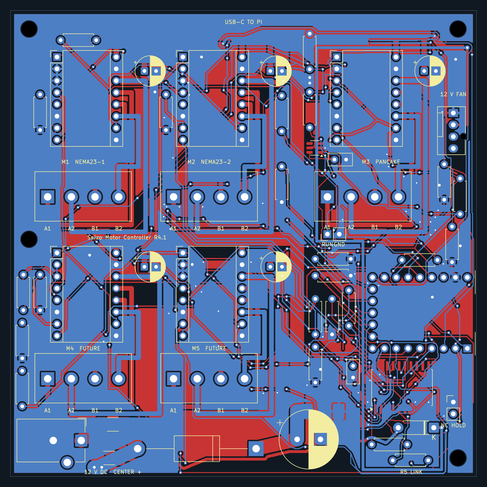
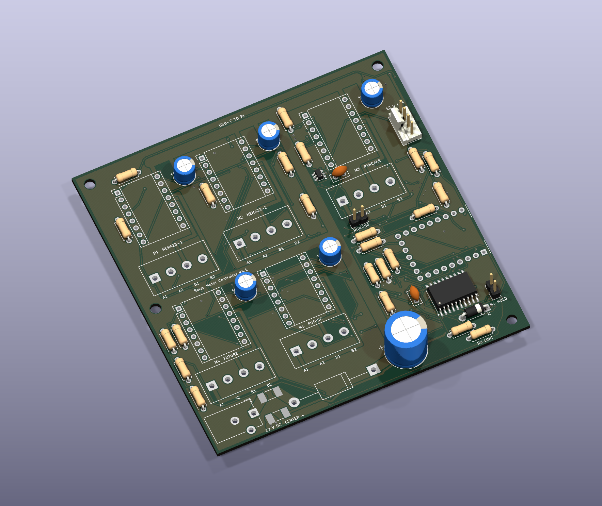

# R4.1 CAD previews

Both images were rendered from the frozen native R4.1 PCB, SHA256 `6f870caf0e68e484de63a360227a2154618d24368472897633d0d671f4e0d3b9`.

These are **CAD renders, not photographs of assembled hardware**. The 3D view is incomplete: J1–J5, U6 and D1 have no body model; the declared U1–U5, F1, F2 and J6 models were unresolved. Missing bodies do not mean those components are unnecessary or absent from the BOM. No substitute bodies were invented. The supplied coverage audit lists every footprint's model status. Real module, socket, connector, heatsink, fan and cable fit still need inspection.
